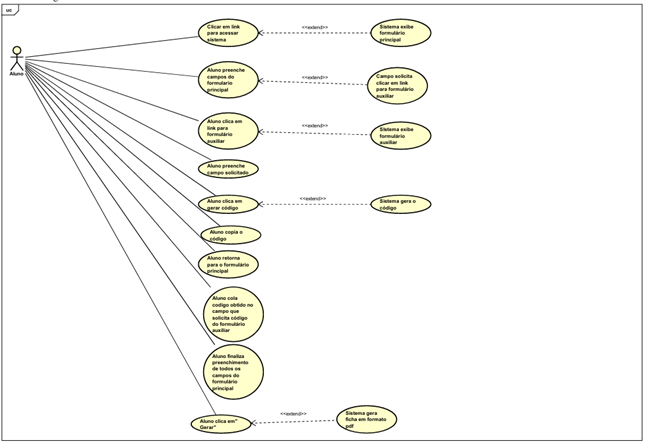
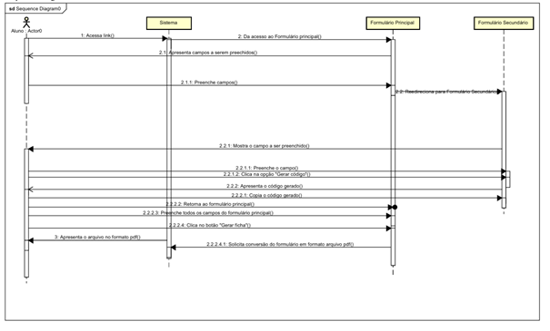
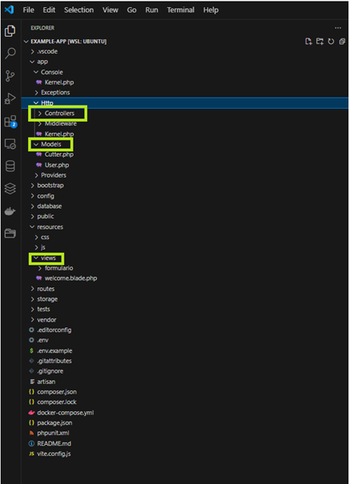
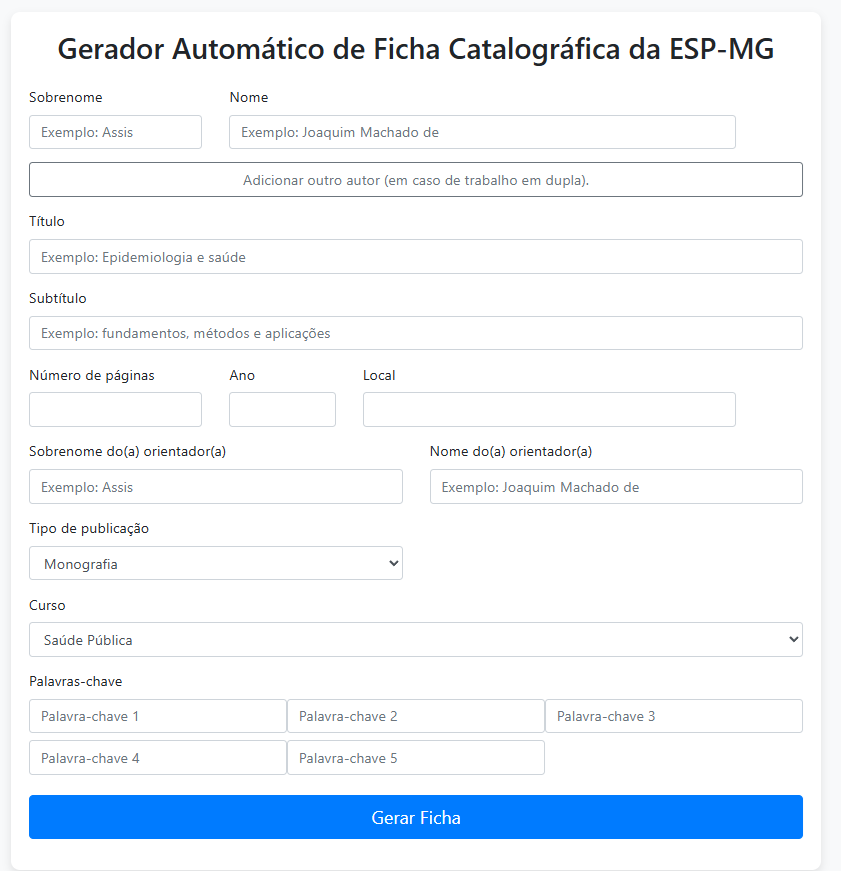
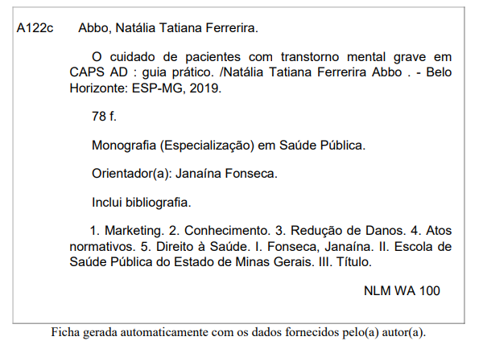

<p align="center"><a href="https://laravel.com" target="_blank"></a></p>

<p align="center">
<a href="https://github.com/laravel/framework/actions"></a>
<a href="https://packagist.org/packages/laravel/framework"></a>
<a href="https://packagist.org/packages/laravel/framework"></a>
<a href="https://packagist.org/packages/laravel/framework"></a>
</p>

## About Laravel

Laravel is a web application framework with expressive, elegant syntax. We believe development must be an enjoyable and creative experience to be truly fulfilling. Laravel takes the pain out of development by easing common tasks used in many web projects, such as:

- [Simple, fast routing engine](https://laravel.com/docs/routing).
- [Powerful dependency injection container](https://laravel.com/docs/container).
- Multiple back-ends for [session](https://laravel.com/docs/session) and [cache](https://laravel.com/docs/cache) storage.
- Expressive, intuitive [database ORM](https://laravel.com/docs/eloquent).
- Database agnostic [schema migrations](https://laravel.com/docs/migrations).
- [Robust background job processing](https://laravel.com/docs/queues).
- [Real-time event broadcasting](https://laravel.com/docs/broadcasting).

Laravel is accessible, powerful, and provides tools required for large, robust applications.

## Learning Laravel

Laravel has the most extensive and thorough [documentation](https://laravel.com/docs) and video tutorial library of all modern web application frameworks, making it a breeze to get started with the framework.

You may also try the [Laravel Bootcamp](https://bootcamp.laravel.com), where you will be guided through building a modern Laravel application from scratch.

If you don't feel like reading, [Laracasts](https://laracasts.com) can help. Laracasts contains over 2000 video tutorials on a range of topics including Laravel, modern PHP, unit testing, and JavaScript. Boost your skills by digging into our comprehensive video library.

## Laravel Sponsors

We would like to extend our thanks to the following sponsors for funding Laravel development. If you are interested in becoming a sponsor, please visit the [Laravel Partners program](https://partners.laravel.com).

### Premium Partners

- **[Vehikl](https://vehikl.com/)**
- **[Tighten Co.](https://tighten.co)**
- **[WebReinvent](https://webreinvent.com/)**
- **[Kirschbaum Development Group](https://kirschbaumdevelopment.com)**
- **[64 Robots](https://64robots.com)**
- **[Curotec](https://www.curotec.com/services/technologies/laravel/)**
- **[Cyber-Duck](https://cyber-duck.co.uk)**
- **[DevSquad](https://devsquad.com/hire-laravel-developers)**
- **[Jump24](https://jump24.co.uk)**
- **[Redberry](https://redberry.international/laravel/)**
- **[Active Logic](https://activelogic.com)**
- **[byte5](https://byte5.de)**
- **[OP.GG](https://op.gg)**

## Contributing

Thank you for considering contributing to the Laravel framework! The contribution guide can be found in the [Laravel documentation](https://laravel.com/docs/contributions).

## Code of Conduct

In order to ensure that the Laravel community is welcoming to all, please review and abide by the [Code of Conduct](https://laravel.com/docs/contributions#code-of-conduct).

## Security Vulnerabilities

If you discover a security vulnerability within Laravel, please send an e-mail to Taylor Otwell via [taylor@laravel.com](mailto:taylor@laravel.com). All security vulnerabilities will be promptly addressed.

## License

The Laravel framework is open-sourced software licensed under the [MIT license](https://opensource.org/licenses/MIT).

# Gerador Automático de Ficha Catalográfica para a ESP-MG

Sistema web desenvolvido para automatizar a geração de fichas catalográficas em formato PDF para a Escola de Saúde Pública do Estado de Minas Gerais (ESP-MG).

O projeto foi inicialmente desenvolvido como Trabalho de Conclusão de Curso (TCC) e possui como objetivo otimizar o processo de geração de fichas catalográficas realizadas pela biblioteca institucional.

---

# Objetivo

O sistema foi desenvolvido para reduzir a morosidade do processo de geração de fichas catalográficas da biblioteca da Escola de Saúde Pública do Estado de Minas Gerais (ESP-MG).

A solução proposta automatiza este fluxo por meio de uma aplicação web capaz de:

* coletar os dados bibliográficos dos alunos;
* gerar automaticamente o código de catalogação;
* produzir fichas catalográficas em formato PDF;
* padronizar o documento conforme a norma AACR2.

---

# Demonstração Visual

## Diagrama de Caso de Uso

O diagrama abaixo representa o fluxo principal de interação do aluno com o sistema para geração automática da ficha catalográfica.



---

## Diagrama de Sequência

O diagrama abaixo representa o fluxo sequencial de interação entre o aluno, o sistema, o formulário principal e o formulário auxiliar durante o processo de geração da ficha catalográfica.



---

## Estrutura da Arquitetura MVC

O projeto foi desenvolvido utilizando a arquitetura MVC (Model-View-Controller), adotada pelo framework Laravel.

A imagem abaixo demonstra a organização das principais camadas da aplicação dentro da IDE Visual Studio Code.



---

## Formulário Principal

O formulário principal é responsável pela coleta das informações bibliográficas necessárias para geração da ficha catalográfica.

A interface foi desenvolvida utilizando HTML e Bootstrap, permitindo padronização visual e facilidade de uso.



---

## Exemplo de Ficha Catalográfica Gerada

Após o preenchimento dos dados bibliográficos, o sistema gera automaticamente a ficha catalográfica em formato PDF.

A estrutura do documento segue o padrão AACR2 (Anglo-American Cataloguing Rules), garantindo padronização e evitando desconfigurações no documento final.



---

# Principais Funcionalidades

* Formulário principal para coleta de dados bibliográficos
* Geração de código Cutter para sobrenome do autor
* Integração com banco de dados MySQL
* Geração automática de ficha catalográfica em PDF
* Padronização conforme norma AACR2
* Interface web responsiva
* Deploy via Docker
* Controle de versão com GitHub

---

# Arquitetura da Solução

O sistema foi desenvolvido utilizando a arquitetura MVC (Model-View-Controller).

## Tecnologias Utilizadas

### Backend

* PHP 8
* Laravel

### Frontend

* HTML
* Bootstrap

### Banco de Dados

* MySQL

### DevOps

* Docker
* GitHub
* Docker Hub

---

# Instalação

```bash
git clone https://github.com/jetioli/Gerador-de-Ficha-Catalografica-com-Laravel.git
cd Gerador-de-Ficha-Catalografica-com-Laravel
```

```bash
docker compose up --build
```

---

# GitHub

Código-fonte disponível em:

```text
https://github.com/jetioli/Gerador-de-Ficha-Catalografica-com-Laravel
```

---

# Docker Hub

Imagem Docker disponível em:

```text
https://hub.docker.com/r/jetioli/gerador-ficha
```

A publicação da imagem no Docker Hub permite:

* facilidade de deploy;
* padronização do ambiente;
* execução simplificada;
* reprodutibilidade da aplicação em diferentes ambientes.

---

```text
https://github.com/jetioli/Gerador-de-Ficha-Catalografica-com-Laravel
```

---

# Autor

Jefferson Timóteo Oliveira
